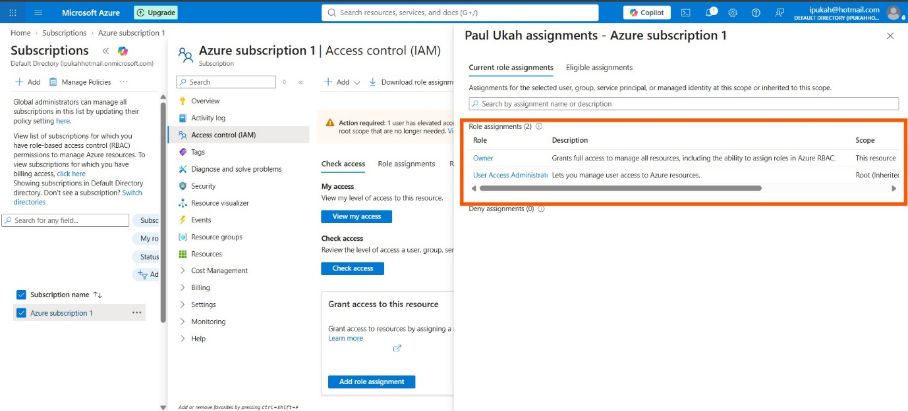
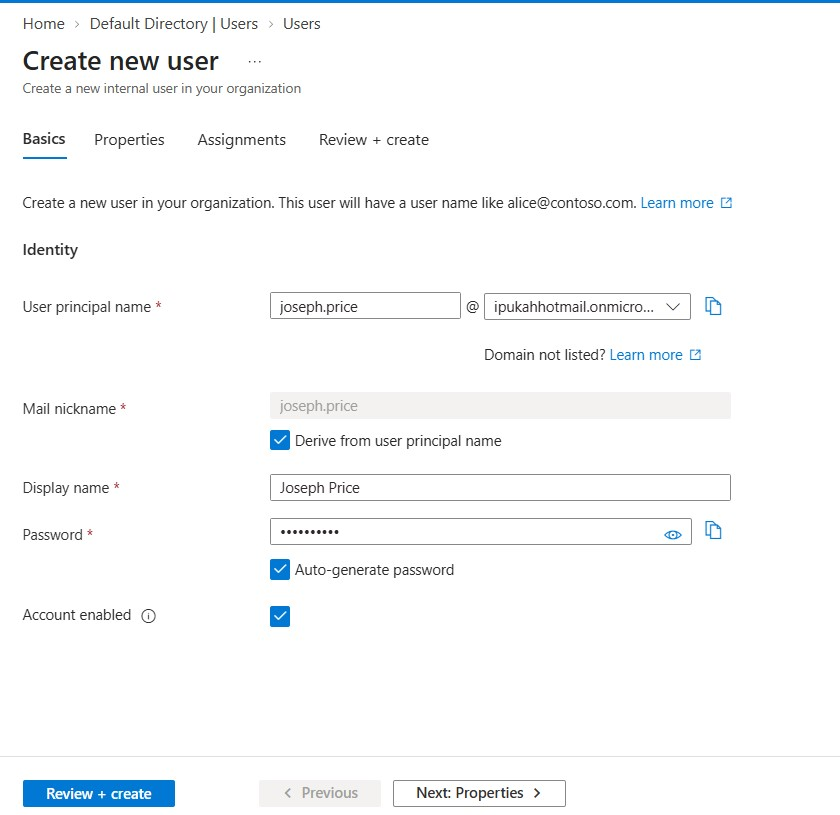
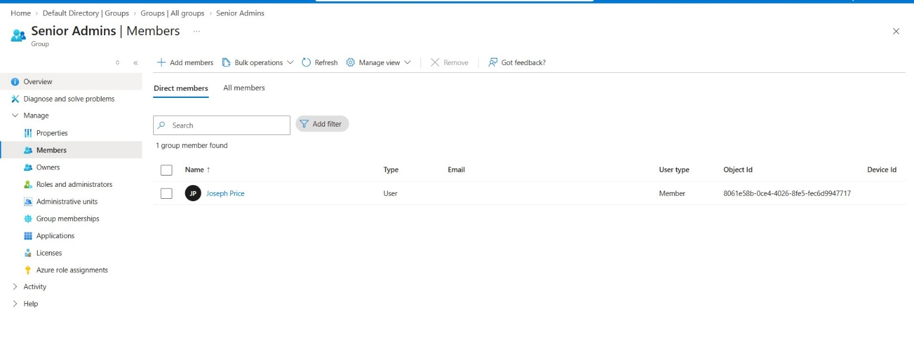
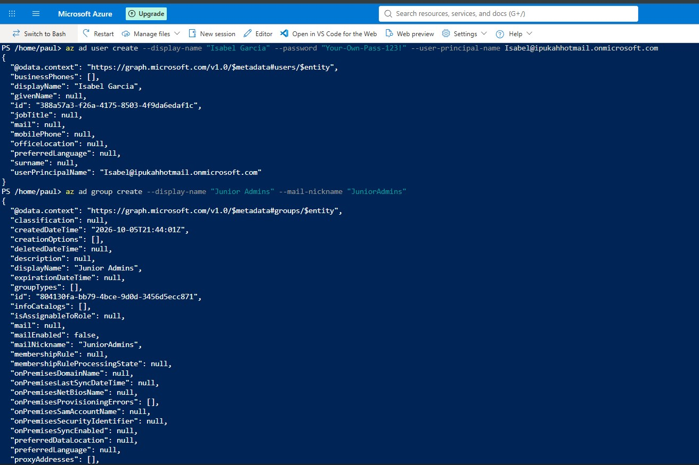
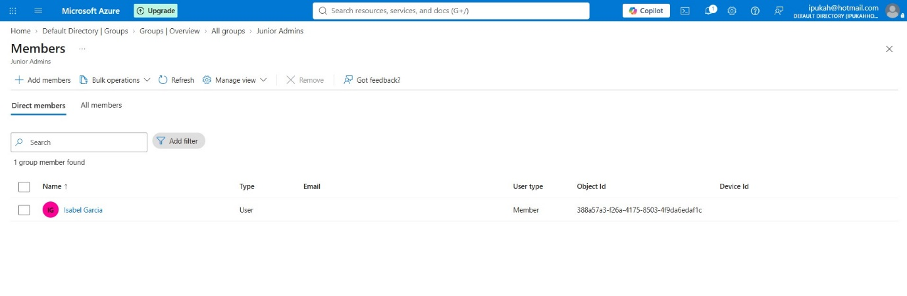
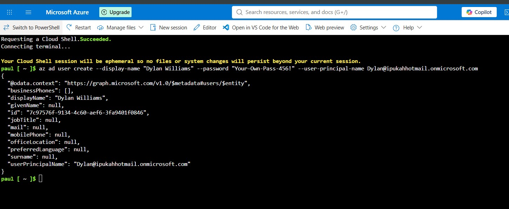
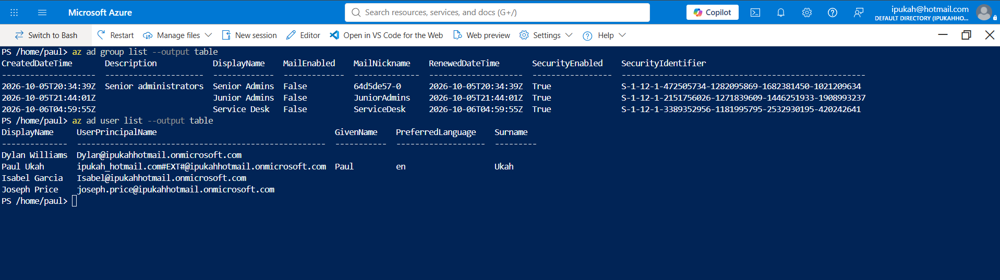
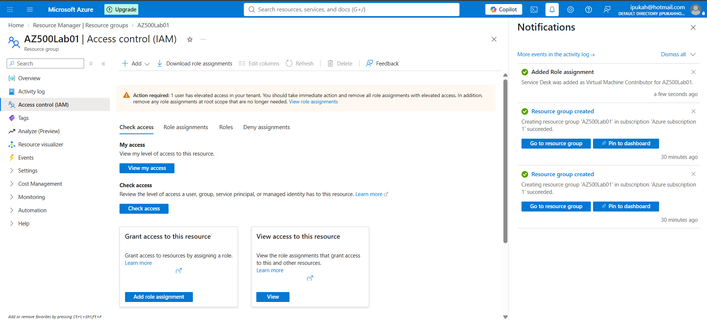
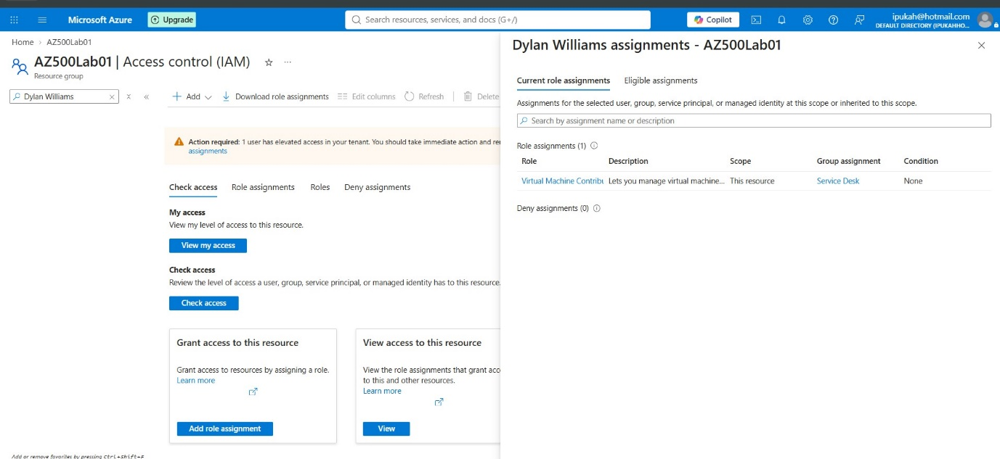
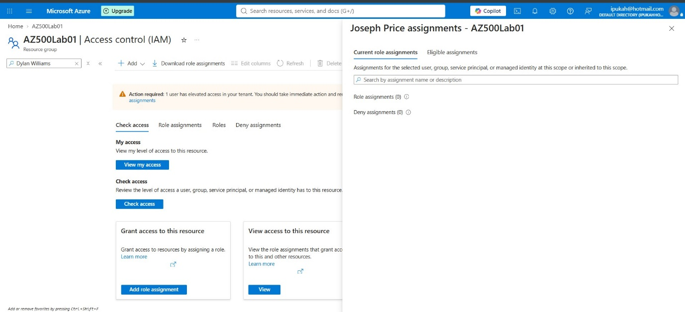

**CLOUD SECURITY SPRINT 2**

**Lab 01: Role-Based Access Control**

Lab report

| **Platform** | Microsoft Azure (free trial subscription), East US region |
| --- | --- |

# 1\. Introduction

Access control is one of the first things a cloud security engineer has to get right. If the wrong person holds the wrong permission, every other control is weakened. This lab is a proof of concept showing how users and groups are created in Microsoft Entra ID and how Azure role-based access control (RBAC) is used to give a group, rather than individual people, the permissions it needs.

The scenario required three groups, each holding one user, and one role assignment:

-   Senior Admins group containing Joseph Price.
-   Junior Admins group containing Isabel Garcia.
-   Service Desk group containing Dylan Williams.
-   The Virtual Machine Contributor role assigned to the Service Desk group.

Each group was created with a different tool (Azure portal, command line) so that the same outcome is shown through more than one method.

# 2\. Overview

## 2.1 Environment and prerequisites

-   Azure free trial subscription with the Owner role.
-   Microsoft Entra tenant with permission to create users and groups.
-   Region: East US.
-   Azure Cloud Shell (no storage account mounted) and Azure CLI.
-   Own passwords were used for all accounts instead of the example password printed in the lab guide.

*Screenshot: Azure subscription overview showing the Owner role assignment*

## 2.2 Exercise 1: Senior Admins group (Azure portal)

1.  Sign in to the Azure portal and open Microsoft Entra ID.
2.  Go to Users, select New user, and create the user Joseph Price with an auto-generated password.
3.  Confirm the user appears under All users.
4.  Go to Groups, select New group, set Group type to Security, Group name to Senior Admins and Membership type to Assigned.
5.  Add Joseph Price as both owner and member, then select Create.

*Screenshot: New user blade for Joseph Price*

*Screenshot: Senior Admins group showing Joseph Price as member*

## 2.3 Exercise 2: Junior Admins group (command line)

The lab guide uses the AzureAD PowerShell module for this exercise. That module is deprecated, so the same steps were completed with Azure CLI from Cloud Shell (see Finding 1). Replace the placeholders with your own values.

1.  Open Cloud Shell and confirm you are signed in to the correct tenant.
2.  Create the user Isabel Garcia.

az ad user create --display-name "Isabel Garcia" --password "<your-password>" --user-principal-name Isabel@<tenant-domain>

1.  Create the Junior Admins group.

az ad group create --display-name "Junior Admins" --mail-nickname "JuniorAdmins"

1.  Find Isabel's object ID and add her to the group.

az ad group member add --group "Junior Admins" --member-id <object-id>

1.  Verify the membership.

az ad group member list --group "Junior Admins" --output table

**

*Screenshot: Cloud Shell output for user and group creation*

*Screenshot: Junior Admins membership list showing Isabel Garcia*

## 2.4 Exercise 3: Service Desk group (Azure CLI)

1.  Create the user, Dylan Williams.

az ad user create --display-name "Dylan Williams" --password "<your-password>" --user-principal-name Dylan@<tenant-domain>

1.  Create the Service Desk group.

az ad group create --display-name "Service Desk" --mail-nickname "ServiceDesk"

1.  Retrieve Dylan's object ID, add him to the group and list the members.

az ad group member add --group "Service Desk" --member-id <object-id>

az ad group member list --group "Service Desk"

1.  List all groups and users to confirm that Senior Admins, Junior Admins and Service Desk, and all three users, now exist.

az ad user list --output table

az ad group list --output table

*Screenshot: Service Desk membership list showing Dylan Williams*

*Screenshot: Table of all three users and all three groups*

## 2.5 Exercise 4: Assign the Virtual Machine Contributor role

1.  Create the resource group AZ500Lab01 in East US.
2.  Open the resource group, then Access control (IAM).
3.  Select Add, then Add role assignment.
4.  Choose the Virtual Machine Contributor role, set Assign access to User, group, or service principal, and select the Service Desk group.
5.  Select Review + assign twice to save the assignment.
6.  On the Check access tab, search for Dylan Williams and view his assignments. Repeat for Joseph Price.

*Screenshot: Resource group AZ500Lab01 after creation*

*Screenshot: Add role assignment with Virtual Machine Contributor and Service Desk selected*

*Screenshot: Check access result for Dylan Williams*

*Screenshot: Check access result for Joseph Price*

# 3\. Findings

## Finding 1: The lab guide relies on a deprecated PowerShell module

| **Where** | Exercise 2, Tasks 1 and 2 |
| --- | --- |
| **Issue** | The guide uses AzureAD module commands (Connect-AzureAD, New-AzureADUser, New-AzureADGroup) and then switches to Az module commands (Add-AzADGroupMember) partway through. The AzureAD module is deprecated. |
| **Resolution** | The exercise was completed with Azure CLI (az ad user create, az ad group create, az ad group member add) from Cloud Shell. The result was identical: user created, group created, user added as member. |
| **Lesson** | Check whether a tool is still supported before building a process on it. Deprecated modules can stop working without warning. |

## Finding 2: Example values in the guide are specific to the lab provider

| **Where** | Exercise 2 |
| --- | --- |
| **Issue** | Commands contain a fixed numeric suffix and a lab-provider tenant domain in the user principal name, group name and filter. These do not exist in a personal trial tenant. |
| **Resolution** | These were replaced with the domain of my own tenant, and group names were kept as the scenario specifies. |
| **Lesson** | Read every command before running it and identify which values are placeholders for your own environment. |

## Finding 3: A default password is published in the guide

| **Where** | Exercises 2 and 3 |
| --- | --- |
| **Issue** | The guide prints a fixed example password for the new accounts. A password that is written in a document that many people use should be treated as public. |
| **Resolution** | Unique passwords were used for each account. No password appears in this report. |
| **Lesson** | Never reuse a documented or shared password, even in a lab. In a real tenant, new accounts should be forced to change their password at first sign-in. |

## Finding 4: Group-based assignment works as intended, and membership alone grants nothing

| **Where** | Exercise 4, Check access |
| --- | --- |
| **Result** | Dylan Williams showed the Virtual Machine Contributor role on AZ500Lab01, inherited through the Service Desk group. Joseph Price showed no assignment on the resource group. |
| **Meaning** | The role was assigned once, to the group, and Dylan received it because he is a member. Joseph is in a group (Senior Admins), but that group holds no role in this lab, so he has no access. Being in a group is not the same as having permission. |
| **Lesson** | Assign roles to groups, then manage access by changing membership. This is easier to audit than assigning roles to individuals, and it supports least privilege. |

## Finding 5: Minor inconsistencies in the guide

-   The resource group is written as both AZ500Lab01 and AZ500LAB01. Azure resource group names are not case sensitive, so this caused no problem, but it can confuse a reader.
-   The guide asks for a resource group in the prerequisites, while Exercise 4 requires a specific named group. The guide's name, AZ500Lab01, was used for the role assignment.
-   Exercise 3 was run from a local terminal with Azure CLI rather than Cloud Shell. This works if you are signed in to the same tenant, but it is an extra step to check.

# 4\. Glossary

| **Term** | **Meaning** |
| --- | --- |
| Microsoft Entra ID | Microsoft's cloud identity service. It stores users and groups and decides who can sign in. |
| Tenant | A dedicated instance of Microsoft Entra ID that belongs to one organisation. |
| User principal name (UPN) | The sign-in name of a user, written like an email address, for example name@domain. |
| Security group | A group used to give permissions to many users at once. |
| Assigned membership | A group type where members are added manually, rather than by a rule. |
| RBAC | Role-based access control. Access is given by assigning roles to identities at a scope. |
| Role assignment | The link between an identity, a role and a scope. |
| Scope | The level at which a role applies: management group, subscription, resource group or resource. |
| Virtual Machine Contributor | A built-in role that lets an identity manage virtual machines, but not the network or storage they connect to, and gives no access to the machine itself. |
| Resource group | A container that holds related Azure resources and allows them to be managed and deleted together. |
| Least privilege | Giving an identity only the access it needs to do its job, and nothing more. |
| Azure CLI | A command-line tool for managing Azure resources. |
| Cloud Shell | A browser-based command line available in the Azure portal. |
| Deprecated | Still present but no longer recommended, and likely to be removed. |

# 5\. Conclusion

All four exercises were completed. Three users and three security groups were created using the Azure portal and Azure CLI, and the Virtual Machine Contributor role was assigned to the Service Desk group at resource group scope. The Check access results confirmed that Dylan Williams receives the role through the group and that Joseph Price does not.

The main lessons were practical. Lab instructions can go out of date, and a deprecated tool should be replaced rather than followed blindly. Example values and passwords must be adapted to your own environment. Most importantly for cloud security, permissions are best given to groups and checked afterwards, so that access follows membership and can be reviewed easily.

The lab resources were removed after testing to avoid unnecessary charges.