**Cloud Security Sprint 2**

**Lab 02: Network Security Groups and Application Security Groups**

Lab documentation and implementation runbook

| **Item** | **Detail** |
| --- | --- |
| **Platform** | Microsoft Azure (Azure Portal and Cloud Shell) |
| **Region** | East US |
| **Resource group** | AZ500LAB07 |
| **Estimated time** | 45 minutes |
| **Required role** | Owner or Contributor on the subscription |
| **Author** | Paul |

# **Introduction**

This document records the implementation of Lab 02 in Cloud Security Sprint 2.

The lab demonstrates how Azure Network Security Groups (NSGs) and Application Security Groups (ASGs) work together to control network traffic between the internet and workloads in a virtual network.

## **Scenario**

The organization runs two groups of servers: Web Servers and Management Servers. Each group sits in its own Application Security Group, and one Network Security Group controls access to both. The aim is least-privilege network access with rules written against workload roles instead of IP addresses.

## **Objectives**

-   Place Web Servers and Management Servers in separate Application Security Groups.
-   Allow RDP (TCP 3389) to the Management Servers only, never to the Web Servers.
-   Serve the default IIS page from the Web Servers to the internet over TCP 80 and 443.
-   Enforce all access control through NSG rules.

## **Prerequisites**

-   An active Azure subscription with the Owner or Contributor role.
-   Resource group AZ500LAB07 in the East US region (confirm the region with your instructor).
-   Basic familiarity with the Azure Portal and Cloud Shell.

# **Overview**

## **Architecture**

| **Component** | **Name** | **Role** |
| --- | --- | --- |
| Virtual network | myVirtualNetwork (10.0.0.0/16) | Hosts the lab subnet |
| Subnet | default (10.0.0.0/24) | Holds both VMs; NSG attached here |
| ASG | myAsgWebServers | Logical group for the web VM NIC |
| ASG | myAsgMgmtServers | Logical group for the management VM NIC |
| NSG | myNsg | Rules Allow-Web-All (100) and Allow-RDP-All (110) |
| VM | myVmWeb | IIS web server in myAsgWebServers |
| VM | myVMMgmt | RDP target in myAsgMgmtServers |

*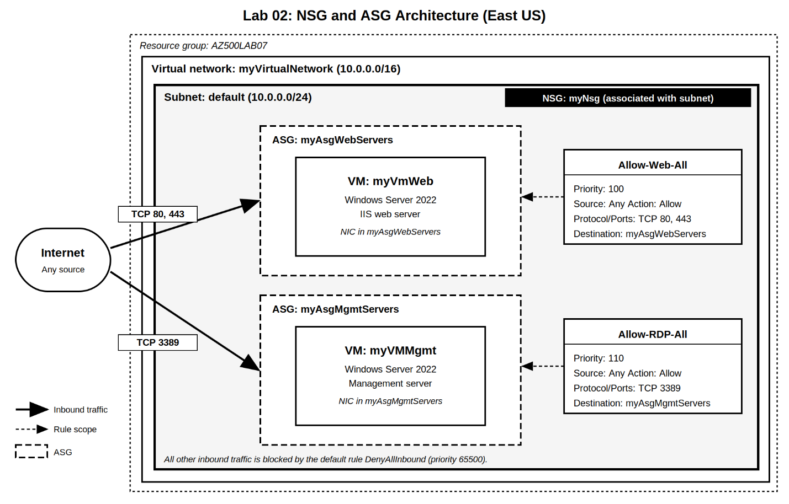Screenshot: architecture diagram showing the VNet, subnet, NSG, two ASGs and two VMs.*

## **Exercise 1: Create the virtual networking infrastructure**

***Task 1: Create a virtual network***

1.  Search for Virtual networks, then select + Create.
2.  On the Basics tab, enter the values below and select Next.

| **Setting** | **Value** |
| --- | --- |
| **Subscription** | Your lab subscription |
| **Resource group** | AZ500LAB07 |
| **Name** | myVirtualNetwork |
| **Region** | East US |

1.  On the IP addresses tab, set the IPv4 address space to 10.0.0.0/16. Edit the subnet named default, set its range to 10.0.0.0/24 and select Save.
2.  Select Review + create, then create.

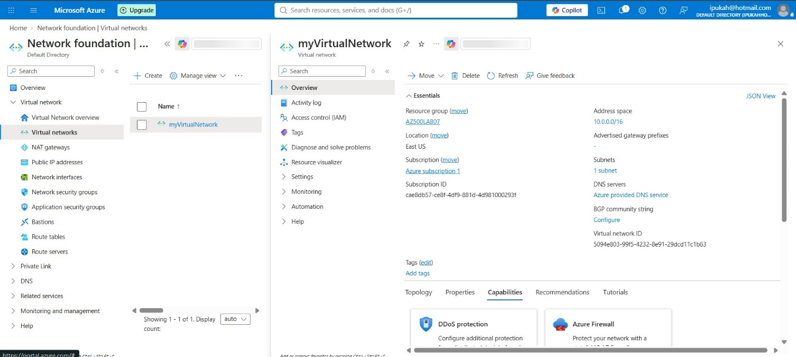*Screenshot: virtual network deployment complete*

***Task 2: Create two application security groups***

1.  Search for Application security groups and select + Create.
2.  Create the web server ASG (resource group AZ500LAB07, name myAsgWebServers, region East US). Select Review + create, then create.
3.  Repeat to create the management ASG named myAsgMgmtServers with the same resource group and region.

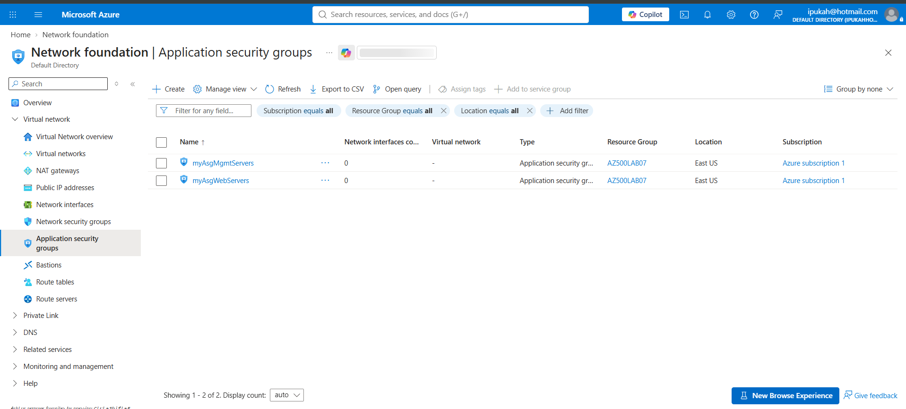*Screenshot: application security groups list showing both ASGs*

***Task 3: Create the NSG and associate it with the subnet***

1.  Search for Network security groups, select + Create and enter: resource group AZ500LAB07, name myNsg, region East US. Select Review + create, then create.
2.  Open myNsg. Under Settings select Subnets, then + Associate.
3.  Select virtual network myVirtualNetwork and subnet default, then OK.  
      
    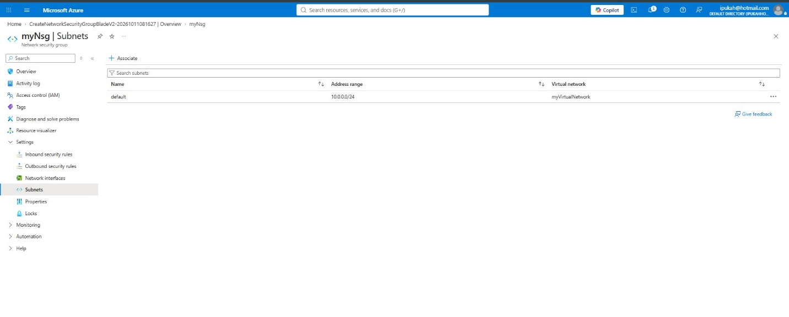  
    *Screenshot: myNsg showing the association with the default subnet*

***Task 4: Create the inbound security rules***

Open myNsg > Settings > Inbound security rules, review the defaults, then select + Add for each rule below. Leave unlisted fields at their defaults.

| **Setting** | **Rule 1** | **Rule 2** |
| --- | --- | --- |
| Source | Any | Any |
| Source port ranges | \* | \* |
| Destination | ASG: myAsgWebServers | ASG: myAsgMgmtServers |
| Service | Custom | Custom |
| Destination ports | 80,443 | 3389 |
| Protocol | TCP | TCP |
| Action | Allow | Allow |
| Priority | 100 | 110 |
| Name | Allow-Web-All | Allow-RDP-All |

*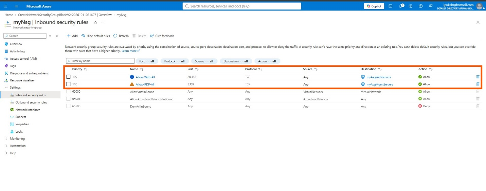*

*Screenshot: myNsg inbound rules showing both custom rules.*

## **Exercise 2: Deploy virtual machines and test the filters**

***Task 1: Create the web server VM***

1.  Search for Virtual machines, then select + Create > Azure virtual machine.
2.  On the Basics tab, enter:

| **Setting** | **Value** |
| --- | --- |
| **Resource group** | AZ500LAB07 |
| **Virtual machine name** | myVmWeb |
| **Region** | (US) East US |
| **Availability options** | No infrastructure redundancy required |
| **Security type** | Standard |
| **Image** | Windows Server 2022 Datacenter: Azure Edition - x64 Gen2 |
| **Size** | Standard D2s v3 |
| **Username** | Student |
| **Password** | Your own strong password (record it securely) |
| **Public inbound ports** | None |
| **Existing Windows Server license** | No |

1.  On the Disks tab, set OS disk type to Standard HDD.
2.  On the Networking tab, select myVirtualNetwork and set NIC network security group to None, because the subnet-level myNsg does the filtering.
3.  On the Monitoring tab, confirm Boot diagnostics is enabled with a managed storage account. Select Review + create, then create.

***Task 2: Create the management VM***

Repeat Task 1 using the name myVMMgmt and the same password. All other values stay identical (public inbound ports None, NIC network security group None). Wait until both VMs show Running.

***Task 3: Associate each NIC with its ASG***

1.  Open myVmWeb > Networking > Network settings > Application security groups tab.
2.  Select + Add application security groups, choose myAsgWebServers and save.
3.  Open myVMMgmt and do the same, choosing myAsgMgmtServers.

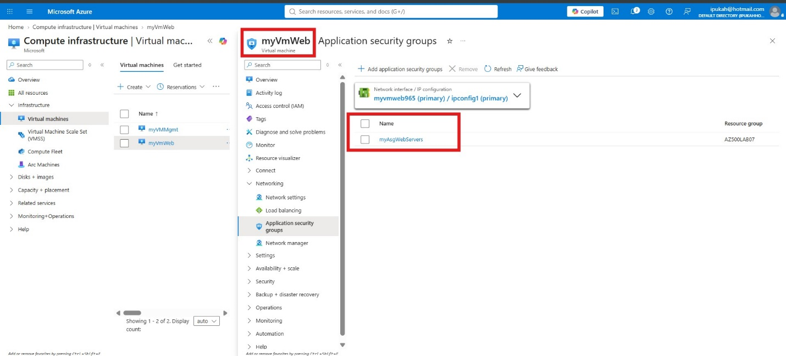

**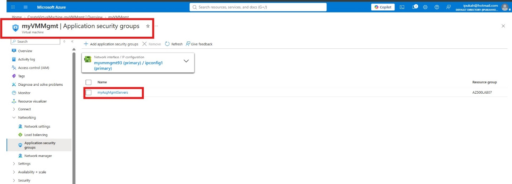**

*Screenshot: Application security groups tab on each VM*

***Task 4: Test the traffic filtering***

**Test A, RDP to the management server.** Open myVMMgmt > Connect > Connect, download the RDP file and sign in as Student. A successful session confirms Allow-RDP-All.

**Test B, IIS on the web server.** Open myVmWeb > Operations > Run command > RunPowerShellScript and run:

***Install-WindowsFeature -name Web-Server -IncludeManagementTools***

  
When the install finishes, copy the public IP address from the myVmWeb Overview and browse to it. The default IIS page should load.

**http://<myVmWeb-public-IP>**

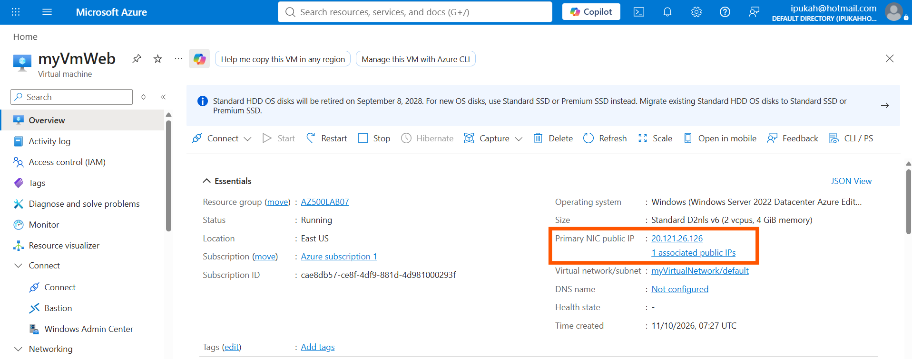

Screenshot: Public IP for myVmWeb

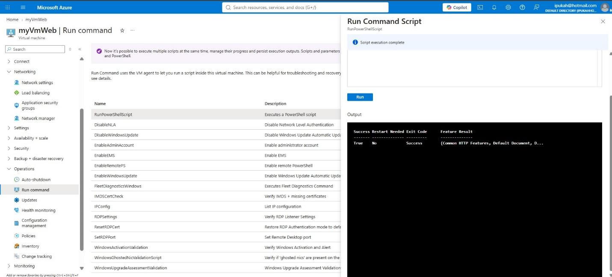

*Screenshot: Installation of IIS script was successful*

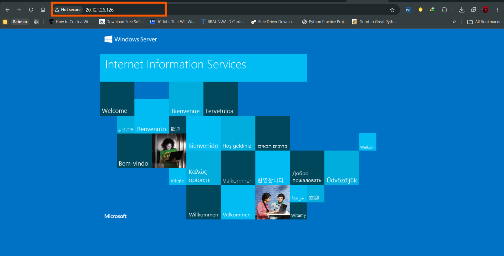

*Screenshot: default IIS welcome page served from the myVmWeb public IP*

**Test C, RDP to the web server (extra).**

Try RDP to the myVmWeb public IP.

It should time out, because no rule allows 3389 to myAsgWebServers and the default DenyAllInbound rule applies.

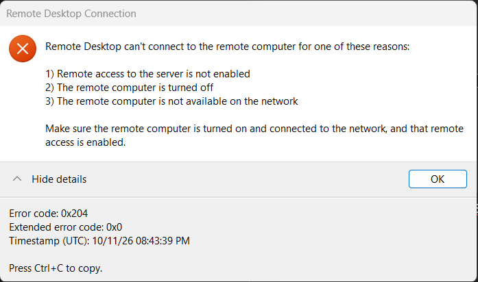

*Screenshot: RDP Access into* ***myVmWeb*** *was blocked as expected*

## **Clean up resources**

In Cloud Shell (PowerShell), run:

***Remove-AzResourceGroup -Name "AZ500LAB07" -Force -AsJob***

***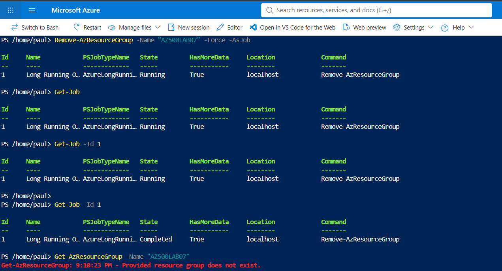***

# **Finding**

## **Test results**

| **Test** | **Target** | **Governing rule** | **Expected result** |
| --- | --- | --- | --- |
| RDP (3389) | myVMMgmt | Allow-RDP-All (110) | Allowed |
| HTTP (80) | myVmWeb | Allow-Web-All (100) | Allowed, IIS page shown |
| RDP (3389) | myVmWeb | DenyAllInbound (65500) | Blocked |
| HTTP (80) | myVMMgmt | DenyAllInbound (65500) | Blocked |

The ASG-based rules enforced the required segmentation. Management access reached only the management server, and web traffic reached only the web server.

## **Security observations**

The lab is deliberately permissive so each control can be demonstrated. These gaps should be closed in production.

| **Observation** | **Risk** | **Recommendation** |
| --- | --- | --- |
| RDP open to Any source on 3389 | Internet-exposed RDP is a common brute-force and ransomware entry point (MITRE ATT&CK T1133, T1110) | Restrict the source to known admin IPs, or use Azure Bastion or JIT VM access (Lab 08) |
| Management VM has a public IP | Larger attack surface | Remove the public IP and use Bastion or VPN |
| Web VM serves HTTP on port 80 | Unencrypted traffic | Enforce TLS, redirect 80 to 443, add Application Gateway with WAF |
| No NSG flow logs | No visibility of allowed or denied traffic | Send NSG flow logs to the Log Analytics workspace (links to Labs 06 and 09) |
| Same password on both VMs | Credential reuse | Use unique credentials, or Entra ID sign-in with secrets in Key Vault |

## **Issues and lab notes**

-   **IIS page does not load:** confirm the Run Command finished, the myVmWeb NIC is in myAsgWebServers, and Allow-Web-All targets that ASG at priority 100.
-   **RDP to myVMMgmt times out:** check the NIC is in myAsgMgmtServers, the VM is Running, and your local network allows outbound 3389.
-   **VM size unavailable:** if Standard D2s v3 is not offered, choose another 2-vCPU size and record the change.

# **Glossary**

| **Term** | **Definition** |
| --- | --- |
| NSG (Network Security Group) | An Azure resource holding ordered allow and deny rules that filter inbound and outbound traffic for subnets or network interfaces. |
| ASG (Application Security Group) | A named group of VM network interfaces that lets NSG rules target workload roles instead of IP addresses. |
| VNet (Virtual Network) | A private, isolated network in Azure that hosts subnets and resources. |
| Subnet | A range of IP addresses inside a VNet; an NSG can be associated with it. |
| NIC | Network interface card; the virtual network adapter attached to a VM. |
| Inbound security rule | A rule that evaluates traffic entering a resource, matched by source, destination, port and protocol. |
| Priority | A number from 100 to 4096; lower numbers are evaluated first, and the first match applies. |
| DenyAllInbound | The default NSG rule (priority 65500) that blocks inbound traffic not matched by any other rule. |
| RDP | Remote Desktop Protocol, used to remotely control Windows machines on TCP 3389. |
| IIS | Internet Information Services, the Windows web server role installed on myVmWeb. |
| Service tag | A named group of Azure IP address prefixes (for example VirtualNetwork, Internet) used in rules. |
| JIT VM access | Just-in-time access in Microsoft Defender for Cloud that opens management ports only on request and for a limited time. |
| Least privilege | Granting only the minimum access required to perform a task. |

# **Conclusion**

Lab 02 delivered a working network segmentation design. Two ASGs separated the web and management workloads, a single subnet-level NSG enforced the policy, and testing confirmed that RDP reached only the management server while HTTP reached only the web server.

## **Key takeaways**

-   ASGs let NSG rules follow the workload role, so rules keep working as VMs are added or moved.
-   Attaching the NSG to the subnet while leaving the NIC-level NSG as None keeps policy in one place.
-   Priority order matters. Lower numbers are evaluated first and unmatched traffic falls to DenyAllInbound.
-   Passing the tests proves function, not security. Restricting source ranges, removing public RDP and enabling flow logs would make this a defensible production design.